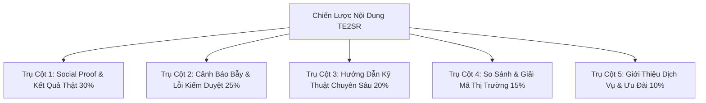

# 04 — 5 Trụ Cột Nội Dung (Content Pillars) & Lịch Đăng Bài Mẫu Tuần Hoàn

> **Quy tắc duy trì sức hút:** Không ai muốn theo dõi một kênh mạng xã hội mà ngày nào cũng chỉ đăng bài bán hàng hoặc quảng cáo dịch vụ. Bạn cần luân chuyển linh hoạt giữa 5 trụ cột nội dung để xây dựng uy tín của một chuyên gia đầu ngành.

---

## 1. Năm Trụ Cột Nội Dung Cốt Lõi Của TE2SR

### 🏆 Trụ Cột 1: Social Proof (Bằng Chứng & Kết Quả Thật — 30%)
* **Nội dung:** Chụp màn hình Play Console của app khách hàng hoàn thành 14 ngày, email thông báo duyệt của Google/Apple, số lượng bug phát hiện được.
* **Mục tiêu:** Xây dựng niềm tin vững chắc ("Đơn vị này làm việc thật, người thật, kết quả thật").

### ⚠️ Trụ Cột 2: Cảnh Báo Bẫy & Lỗi Kiểm Duyệt (25%)
* **Nội dung:** Phân tích các lỗi khiến app bị từ chối (Guideline 4.0, tài khoản bị khóa vì dùng bot farm, bẫy đếm ngày).
* **Mục tiêu:** Giữ chân người xem, tạo cảm giác biết ơn vì được cảnh báo trước nguy cơ mất thời gian và tài khoản.

### 📚 Trụ Cột 3: Hướng Dẫn Kỹ Thuật Bước-Từng-Bước (20%)
* **Nội dung:** Cách điền form Data Safety, kích thước ảnh chụp màn hình chuẩn cho cả iPhone và iPad, cách trả lời bảng hỏi Production Access.
* **Mục tiêu:** Định vị TE2SR là chuyên gia hàng đầu trong ngành phát hành ứng dụng di động.

### ⚖️ Trụ Cột 4: So Sánh & Giải Mã Thị Trường (15%)
* **Nội dung:** So sánh giữa việc tự nhờ bạn bè test vs thuê dịch vụ chuyên nghiệp; rủi ro giữa dịch vụ bot $15 vs dịch vụ máy thật $50.
* **Mục tiêu:** Giáo dục khách hàng hiểu vì sao mức giá $50 / $70 / $100 kèm bảo hành 2 đợt là lựa chọn thông minh nhất.

### 🎯 Trụ Cột 5: Giới Thiệu Dịch Vụ & Cam Kết (10%)
* **Nội dung:** Nêu rõ các gói dịch vụ, chính sách trả góp 2 đợt (50% khi đủ 12 máy, 50% khi app live) và cam kết hoàn tiền 100%.
* **Mục tiêu:** Chốt đơn những khách hàng đã theo dõi các bài viết trước và đang có nhu cầu nộp app ngay.

---

## 2. Lịch Đăng Bài Mẫu Tuần Hoàn 7 Ngày

| Thứ | Trụ cột | Chủ đề bài viết gợi ý | Hình ảnh đính kèm |
| :--- | :--- | :--- | :--- |
| **Thứ 2** | 📚 Kỹ thuật | Hướng dẫn tính đúng 14 ngày closed testing từ ngày duyệt bài | Ảnh đồ họa nhận diện hoặc sơ đồ timeline |
| **Thứ 3** | 🏆 Social Proof | Chúc mừng 1 ứng dụng vừa hoàn thành 14 ngày & mở quyền Production | Ảnh chụp màn hình Console gạch ngang 3 điều kiện |
| **Thứ 4** | ⚠️ Cảnh báo | Tại sao máy ảo emulator lại bị Google Play Integrity API phát hiện | Ảnh cảnh báo đỏ / so sánh máy ảo vs máy thật |
| **Thứ 5** | 📚 Kỹ thuật | Cách fix lỗi Apple Guideline 4.0 Minimum Functionality cho app Flutter | Ảnh code hoặc giao diện App Store Connect |
| **Thứ 6** | ⚖️ So sánh | 3 rủi ro chí mạng khi nhờ bạn bè test app giùm | Ảnh meme dev hoặc hình minh họa |
| **Thứ 7** | 🎯 Chốt dịch vụ | Giới thiệu chính sách thanh toán 2 đợt & nhận test app cho tuần mới | Ảnh bảng giá $50/$70/$100 kèm link website |
| **Chủ Nhật** | ☕ Nghỉ ngơi | Q&A: Giải đáp thắc mắc kiểm thử của anh em dev trong tuần | Text ngắn + kêu gọi comment câu hỏi |
